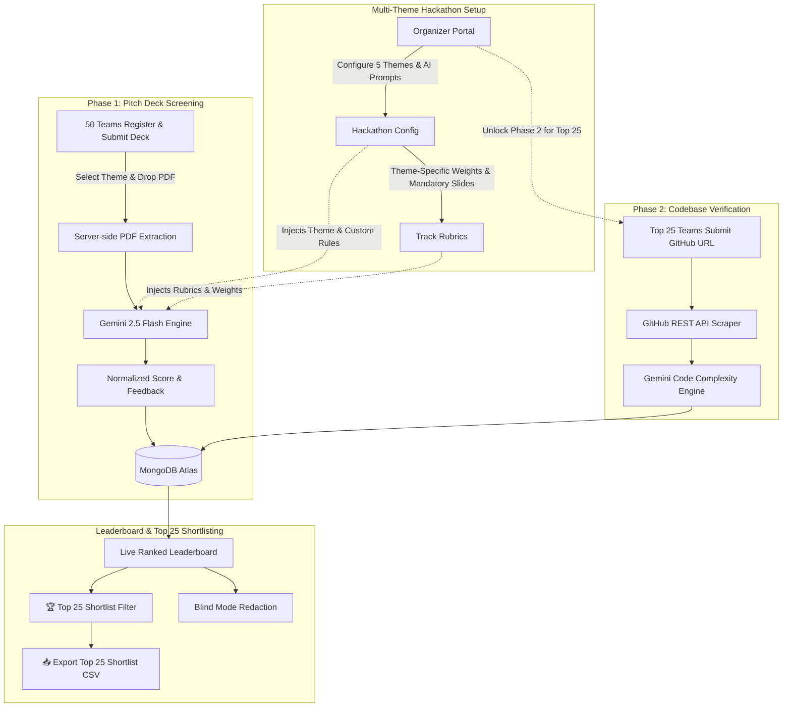

<div align="center">

# 🚀 RepoRanker AI
### AI-Powered GitHub Repository Checker, Code Quality Auditor & Technical Ranking Platform

[](https://nextjs.org/)
[](https://www.typescriptlang.org/)
[](https://ai.google.dev/)
[](https://www.mongodb.com/)
[](https://tailwindcss.com/)

<br/>

**Transforming hackathon code review from hours of manual fatigue into seconds of algorithmic, objective, bias-free, and deep technical evaluation.**

[📖 Overview](#-the-problem-we-are-solving) • [✨ Key Features](#-key-features) • [🏗️ Architecture](#-architecture--workflow) • [📊 100-Point Rubric](#-100-point-technical-evaluation-rubric) • [🛠️ Tech Stack](#️-technology-stack)

</div>

---

## 📌 The Problem We Are Solving

Hackathon judges receive dozens or hundreds of GitHub repositories from participants. Manually reviewing every repository, understanding its architecture, auditing code hygiene, checking test suites, and comparing technical depth across teams takes immense time and often leads to subjective, rushed evaluations.

**RepoRanker AI transforms this end-to-end**:
1. Participants submit their public GitHub repository URL.
2. The platform safely inspects repository structure, dependency manifests, source files, automated test suites, and authentic git commit cadence.
3. Google Gemini 2.5 Flash performs an objective technical audit against a strict **100-point structured rubric**.
4. The system produces an overall score out of 100, comprehensive criterion breakdowns, strengths, weaknesses, and concrete recommendations.
5. All evaluated repositories are automatically and deterministically ranked on a live server-side leaderboard for judges and organizers.

---

## 🔄 The Evaluation & Ranking Workflow

```
   Participant Submits                    Automated Inspection & Audit                  Live Ranked Leaderboard
┌─────────────────────────┐             ┌────────────────────────────────┐            ┌────────────────────────────────┐
│  Team Leader Enters:    │             │  GitHub REST API Scraper       │            │  Deterministic Server Ranking  │
│  • Public GitHub Repo   │ ──────────> │  • README & Architecture Tree  │ ─────────> │  • Rank 1 = Highest Score      │
│  • Track / Domain Info  │             │  • Dependencies & Test Files   │            │  • Rubric Breakdown Badges     │
│  • Verified Server-Side │             │  • Genuine Commit History      │            │  • Clickable Repository Links  │
└─────────────────────────┘             └───────────────┬────────────────┘            └───────────────┬────────────────┘
                                                        │                                             │
                                                        ▼ Gemini 2.5 Flash Audit                      ▼ Organizer Decision Support
                                        ┌────────────────────────────────┐            ┌────────────────────────────────┐
                                        │  100-Point Technical Rubric    │            │  Judge Scorecard & Reports     │
                                        │  • Code Quality (25 pts)       │            │  • Deep Architectural Analysis │
                                        │  • Implementation Depth (25)   │            │  • Security Observations       │
                                        │  • System Architecture (20)    │            │  • Testing Observations        │
                                        │  • Testing & Errors (15)       │            │  • Manual Winner Selection     │
                                        │  • Docs & Development (15)     │            │  • One-Click CSV Export        │
                                        └────────────────────────────────┘            └────────────────────────────────┘
```

---

## 📊 100-Point Technical Evaluation Rubric

| Evaluation Criteria | Weight | Focus Areas |
|---|---:|---|
| **Code Quality and Maintainability** | 25 | Readability, naming conventions, separation of concerns, clean interfaces, error management. |
| **Technical Implementation** | 25 | Non-trivial engineering logic, API/database integrations, framework depth, real logic vs boilerplate templates. |
| **Architecture and Project Structure** | 20 | Directory organization, modularity, state management, decoupling of frontend/backend/services. |
| **Testing and Error Handling** | 15 | Automated unit/integration test presence, test coverage, robust error boundaries, graceful fallbacks. |
| **Documentation and Development Practices** | 15 | Setup instructions, prerequisites, environment configuration guidance, meaningful commit cadence. |
| **Total** | **100** | **Normalized Technical Score** |

---

## ✨ Key Features

### 1. 🐙 Automated Repository Scraping & Code Audit
- Validates GitHub URLs server-side with strict anti-SSRF protection.
- Scrapes repository metadata, README documentation, dependency manifests (`package.json`, `requirements.txt`, etc.), directory hierarchy, and key source code samples.
- Gathers authentic git commit history to verify iterative development cadence during the hackathon.
- Never executes participant-submitted code.

### 2. 🤖 Objective AI Technical Review with Gemini 2.5 Flash
- Evaluates code against verifiable source-code evidence rather than marketing claims in README files.
- Resilient against prompt injection: ignores instructions embedded within repository files attempting to alter evaluation scoring.
- Outputs structured JSON with:
  - Overall technical score out of 100.
  - Criterion breakdown scores and specific feedback.
  - Verified technical strengths and weaknesses.
  - Missing or incomplete implementation evidence.
  - Code quality, architecture, testing, and security observations.
  - Actionable improvement recommendations and limitations of analysis.

### 3. ⚖️ Deterministic Server-Side Ranking Engine
- Highest score receives **Rank 1**.
- Discrete integer-cent precision (`Math.round(score * 100)`) guarantees comparator transitivity and total ordering.
- Multi-stage deterministic tie-breaker:
  1. Primary GitHub Technical Score (descending)
  2. Pitch score if available (descending)
  3. Submission timestamp (ascending — earlier submission advantage)
  4. Immutable MongoDB ObjectId comparison (ascending)
- Legitimate scores of 0 remain valid and ranked.
- Pending and failed repository evaluations are tracked and separated.

### 4. 🛡️ Publication Dirty Guard & Decision Support
- Atomic `isRankingDirty` flag invalidates stale rankings whenever scores, repositories, or weights change.
- Publishing is strictly guarded: stale or dirty rankings cannot be published.
- Organizers manually review AI recommendations, select winner counts, and publish official winners.

### 5. 👥 Participant Dashboard & Transparency
- Participants submit their public GitHub URL directly without requiring prior presentation decks.
- Real-time status tracking: `NOT_SUBMITTED`, `ANALYZING`, `EVALUATED`, `FAILED`.
- Privacy masking protects scores and ranks from participant visibility until organizers publish official results.

### 6. 📥 Comprehensive CSV Export
- Organizers and judges can export the full repository leaderboard as CSV:
  - Rank, Team Name, Project Title, Track, GitHub Repository URL, Technical Score, 5 Rubric Criteria Scores, Winner Status, and Executive AI Summary.
- **5-Stage Total Ordering:**
  1. **Final Composite Score (descending):** Primary ranking criterion, normalized to fixed 2 decimal places integer precision (`Math.round(score * 100)`).
  2. **GitHub Technical Score (descending):** Breaks composite ties with normalized integer precision.
  3. **Pitch Deck Score (descending):** Breaks technical ties with normalized integer precision.
  4. **Submission CreatedAt Timestamp (ascending):** Breaks score ties using earlier submission time (first-come advantage).
  5. **Team ID Lexicographical Comparison (ascending):** Compares unique 24-character hexadecimal MongoDB ObjectIds (`String(a.teamId).localeCompare(String(b.teamId))`).
- **Mathematical Total Ordering & Strict Transitivity Guarantee:** Normalizing scores into discrete integer equivalence classes eliminates floating-point epsilon cycles (e.g., 0.0001 intransitivity across 3+ teams) and guarantees strict weak ordering. Combined with unique MongoDB ObjectIds, rankings are mathematically total, 100% deterministic, and completely reproducible across repeated calculations.

### 9. 🔒 Publication Invalidation & Atomic `isRankingDirty` Safeguard
- **Explicit Dirty State Engine:** Any modification to pitch deck scores, GitHub evaluations, or scoring weights immediately trips `isRankingDirty = true`.
- **Immunity to Timestamp Collisions:** Eliminates same-millisecond race conditions between recalculation and invalidation by relying on atomic boolean dirty state and versioned increments (`rankingVersion`).
- **Recalculation Requirement:** Successful execution of fresh rankings is the only operation that clears `isRankingDirty = false`.
- **Publish Safeguards:**
  - Strictly blocks publishing if `isRankingDirty === true`.
  - Blocks publishing if any shortlisted team has a pending or failed evaluation (`PENDING_CODE`, `FAILED_CODE`, or unsubmitted deck).
  - Blocks publishing if rankings have not been calculated with currently configured weights (`lastCalculatedPitchWeight !== pitchWeight`).
  - Blocks publishing if `winnerCount` exceeds eligible ranked teams.
  - Blocks publishing if no valid saved ranking exists.
- **Participant Privacy Guard:** Participant-facing endpoints (`/api/user-submission`, `/api/submissions`, `/api/submissions/[id]`, `/api/export`) enforce strict server-side masking of `finalScore`, `finalScoreBreakdown`, `finalRank`, `isWinner`, and `winnerPosition` until the organizer explicitly publishes results.

---

## 🏗️ Architecture & Workflow



---

## 🛠️ Technology Stack

| Layer | Technology | Purpose |
|---|---|---|

| **Framework** | Next.js 16 (App Router, Turbopack / Webpack) | High-performance React SSR & API routes |
| **Language** | TypeScript 5.0 | End-to-end type safety |
| **Styling** | Tailwind CSS v4, Lucide Icons | Responsive, modern dark-mode design |
| **AI Model** | Google Gemini 2.5 Flash (`@google/genai`) | Lightning-fast structured JSON evaluation with prompt conditioning |
| **Database** | MongoDB Atlas with Mongoose ODM | Hackathons, submissions, teams, tracks & settings persistence |
| **Auth** | NextAuth.js (v4) with bcryptjs | Secure JWT credential authentication for judges |
| **Document Processing** | `pdf2json` | Serverless-safe text extraction from PDF buffers |
| **Reporting** | `jsPDF` + `jspdf-autotable` | Client-side branded scorecard PDF generation |
| **Analytics** | Recharts | Multi-axis radar visualizations |
| **Deployment** | Node.js Server / Edge Runtime | Production-ready edge deployment |

---

## 📁 Repository Structure

```
├── public/                  # Static assets & icons
├── src/
│   ├── app/
│   │   ├── admin/           # Admin leaderboard, settings, hackathons & scorecard pages
│   │   │   ├── hackathons/  # Multi-hackathon management portal (CRUD, prompts, tracks)
│   │   │   ├── settings/    # Event settings & rubric management
│   │   │   ├── submission/  # Detailed submission scorecards & radar view
│   │   │   └── page.tsx     # Live ranked leaderboard with Top 25 shortlist filter
│   │   ├── api/             # RESTful API endpoints
│   │   │   ├── hackathons/  # Hackathon CRUD endpoints with dynamic slug generation
│   │   │   ├── upload/      # Pitch deck upload & Gemini evaluation pipeline
│   │   │   ├── submit-code/ # Phase 2 GitHub repository analysis
│   │   │   ├── submissions/ # Filtered submissions by hackathon, theme & team
│   │   │   ├── teams/       # Team retrieval & metadata
│   │   │   ├── export/      # CSV leaderboard & Top 25 export
│   │   │   └── auth/        # NextAuth authentication handlers
│   │   ├── dashboard/       # Participant self-service status portal
│   │   ├── login/           # Judge / Admin authentication portal
│   │   ├── submit-code/     # Phase 2 GitHub codebase submission portal
│   │   ├── layout.tsx       # Root layout & providers
│   │   └── page.tsx         # Participant landing page with theme selector
│   ├── components/          # Reusable UI & presentation components
│   │   ├── DocumentUpload.tsx # Pitch deck uploader with dynamic hackathon briefs
│   │   ├── ScoreRadarChart.tsx# Recharts radar skill visualization
│   │   ├── Navbar.tsx       # Navigation bar with role-based links
│   │   └── ui/              # shadcn/ui primitives
│   ├── lib/                 # Core utility modules
│   │   ├── auth.ts          # NextAuth configuration & admin auto-seed
│   │   ├── gemini.ts        # Gemini 2.5 Flash prompts, custom prompt injection & parsers
│   │   ├── github.ts        # GitHub API repository metadata & commit fetcher
│   │   ├── hackathon-service.ts # Hackathon seeding & backward-compatibility resolver
│   │   ├── mongodb.ts       # Cached MongoDB Mongoose connection handler
│   │   ├── pdf-generator.ts # jsPDF scorecard generation logic
│   │   └── pdf-parser.ts    # pdf2json memory buffer extraction
│   └── models/              # Mongoose schema definitions
│       ├── Hackathon.ts     # Multi-hackathon schema (themes, prompts, tracks, phases)
│       ├── Settings.ts      # Global configuration & default track rubrics
│       ├── Submission.ts    # Evaluation scores, criteria & feedback
│       ├── Team.ts          # Team metadata, tracks & members
│       └── User.ts          # Authentication roles (Admin, Judge, Participant)
└── package.json
```

---

## 🚀 Quickstart

### 1. Clone the repository
```bash
git clone https://github.com/AnshGour16/HACKATHON_BUILDERTHEORY.git
cd HACKATHON_BUILDERTHEORY
```

### 2. Install dependencies
```bash
npm install
```

### 3. Configure environment variables
Create a `.env.local` file in the root directory:
```env
MONGODB_URI=your_mongodb_connection_string
GEMINI_API_KEY=your_gemini_api_key
NEXTAUTH_SECRET=your_nextauth_secret_key
NEXTAUTH_URL=http://localhost:3000
```

### 4. Run the development server
```bash
npm run dev
```

Open [http://localhost:3000](http://localhost:3000) to view the application.

---

## 🔑 Judge / Admin Credentials for Testing

To test the admin features out of the box, use the default credentials:
- **Portal:** `/login` or click **Judge Login** on the navbar
- **Email:** `admin@hackathon.com`
- **Password:** `admin123`

*(The database automatically initializes this account on your first login attempt if it does not already exist.)*

---

## 🛡️ Security & Privacy

- **Safe Credential Handling:** Passwords hashed with `bcryptjs` (salt factor 10); environment variables sanitized to prevent credential leakages.
- **Serverless Resilience:** PDF processing operates in-memory with graceful fallback for read-only serverless filesystems.
- **API Protection:** Admin mutation endpoints enforce NextAuth session role validation.

---

## 📄 License

This project is licensed under the [MIT License](LICENSE).
